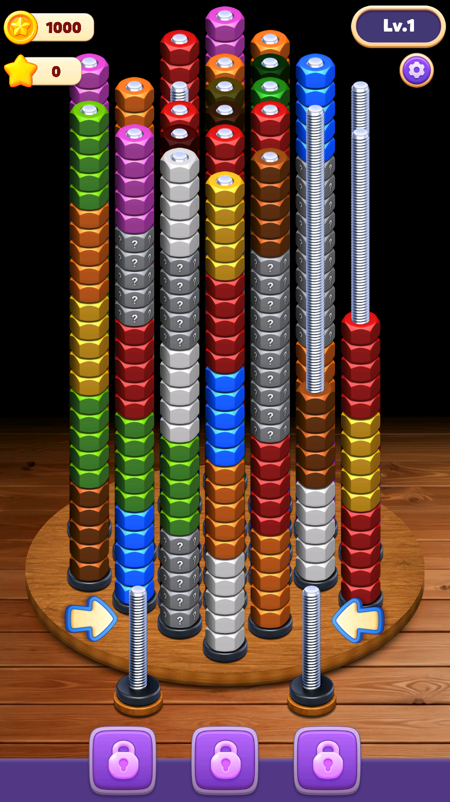

# Game Market Scout — Stack Sort

**Target:** Nut Stack: Sort Puzzle  
**Android:** `com.nut.stack.sort.puzzle`  
**iOS:** `6791946629` / `nut.sort.color.puzzle.screw.stack.organize`  
**Evidence date:** 2026-10-16  
**Period:** 2026-07-19–2026-10-16; latest 30 days emphasized  
**Overall confidence:** Medium

## Recommendation

**Advance Stack Sort as an Android-first market candidate. Do not treat iOS as an independent proof of scale.**

Why:

1. Sensor Tower public estimate shows **200k Android worldwide downloads last month**, inside an exact-match cluster with several **200k–300k** listings.
2. US Android Casual free rank improved **#188→#31** from Sep 12 to Oct 16; AU, CA, and GB also reached top-55 Casual positions.
3. Target adds a distinctive high-stack, mystery-nut/locked-layer presentation to a proven color-sort loop.
4. iOS is much smaller at **8k worldwide downloads last month**. Exact-match **Nuts Factory** is the better iOS benchmark at **40k downloads and $100k store revenue**.

**Winner:** Nut Stack: Sort Puzzle on Android — strongest observed recent Tier-1 momentum and differentiation.  
**Backup/reference:** Nuts Factory: Nut Sort Puzzle on iOS — stronger iOS scale, progression breadth, and IAP signal.  
**Android scale backup:** Nut Sort Puzzle: Sorting Games — 300k public worldwide monthly estimate.

## Market evidence

| Platform | Worldwide | US / Tier-1 | Conclusion |
|---|---|---|---|
| Android | 200k downloads; < $5k store revenue; Play install range 500k–1M | US Casual #31; AU #29; CA #34; GB #55 on Oct 16 | Main opportunity; likely IAA/hybrid, but ad revenue unavailable |
| iOS | 8k downloads; < $5k store revenue | US Casual #103 and Puzzle #107 on Oct 16 | Recent launch momentum, insufficient current scale alone |

Figures are Sensor Tower public “Last Month” estimates accessed via Playwright on 2026-10-16. Exact period definition, US download totals, retention, engagement, and ad revenue were unavailable without an authenticated subscription session. US is not added to worldwide; cross-platform users are not summed.

### Is it viral?

**Unverified.** Category rankings improved sharply, but direct downloads for matched latest-30 and preceding-30 periods were inaccessible. Rank momentum is not substituted for download growth.

## Product evidence

- Official descriptions confirm same top-nut transfer loop on Android and iOS.
- Fresh Android level 1 uses extremely tall stacks, hidden `?` nuts, spare bolts, and three locked slots.
- Presentation is visually differentiated but crowded; first-level readability is a product risk.
- Store reviews contain anecdotal complaints about black/locked stacks and requests for more variation.
- Protected Cocos asset pack contains 12,631 opaque files; trustworthy level count and uniqueness could not be established.

## Configuration integrity

- Firebase Remote Config is registered, but live US/GB/CA/AU/HK fetches all returned `NO_TEMPLATE`.
- Game uses custom country, hot-update, and analytics endpoints.
- Normal clean run persisted country `HK`, runtime group `167`, rollout `28`.
- Controlled US client-country response persisted `US` but retained group `167` and the same level-1 core layout.
- No evidence establishes an intentional fake/decoy config.
- **Limit:** public network egress remained Hong Kong, so server-side US-IP targeting is unverified. Conclusion is scoped to client-country targeting only.

## Advertising

Sensor Tower public pages mark Android and iOS as **actively advertised**. However, Creative Gallery redirected to the demo page because the Playwright session was not authenticated. No top-10 paid creative set, spend, Impression Share, network mix, or country allocation was available. Official screenshots were reviewed only as store creatives.

High ad activity does not prove profitability. Broad Android ad-SDK integration and low public IAP estimate support an **IAA/hybrid inference**, not a total-revenue claim.

## Decision boundaries

### Supports recommendation

- Exact mechanic cluster sustains several 200k–300k Android monthly estimates.
- Target’s Android Tier-1 rank trend is strong and current.
- Active updates and advertising on both platforms.
- Distinct mystery-nut/high-stack gameplay presentation.

### Blocks stronger recommendation

- No authenticated Sensor Tower downloads/revenue export.
- No matched 30-day download growth, retention, time spent, or DAU/MAU.
- No paid creative inspection or Impression Share.
- No true US-egress config run.
- No verified level count or iOS package parity.

## Files

- [Android report](android.md)
- [iOS report](ios.md)
- [Candidate set](candidates.csv)
- [Observed level screenshot](media/level1-us-signal.png)

## Primary sources

- [Google Play target listing](https://play.google.com/store/apps/details?id=com.nut.stack.sort.puzzle)
- [App Store target listing](https://apps.apple.com/us/app/nut-stack-sort-puzzle/id6791946629)
- [Apple Lookup API](https://itunes.apple.com/lookup?id=6791946629)
- [Sensor Tower Android public overview](https://app.sensortower.com/overview/com.nut.stack.sort.puzzle?country=US)
- [Sensor Tower iOS public overview](https://app.sensortower.com/overview/6791946629?country=US)
- Local versioned APK/runtime/network evidence under `bin/com.nut.stack.sort.puzzle/reverse/` (Git-ignored)
